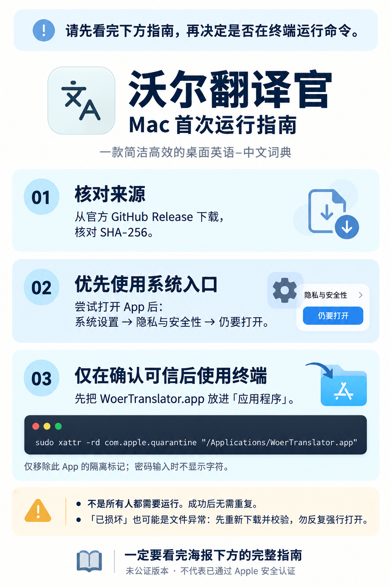

# Mac 首次运行指南

**请先看完下方指南，再决定是否在终端运行命令。** 并不是每个用户都需要清除隔离标记；成功后不需要重复运行。



## 先确认下载来源与文件完整性

仅从[本项目的 GitHub Releases](https://github.com/blueaaa333/woer-translator/releases/latest)下载。Apple 芯片选 `macOS-arm64`，Intel 芯片选 `macOS-x64`。同一版的 `SHA256SUMS.txt` 列出发行文件的校验值。

打开“终端”，输入 `shasum -a 256 `（最后保留一个空格），把刚下载的 DMG 或 PKG 文件从 Finder 拖入终端，再按回车。将输出开头的 64 位值与同一 Release 的 `SHA256SUMS.txt` 对应文件行逐字比较。校验值不一致时停止安装，重新从 Release 下载；校验一致说明文件与发布者提供的一致，并不等于 Apple 已验证软件安全。

DMG 用户：把 `WoerTranslator.app` 拖到“应用程序”；PKG 用户：按安装器提示完成安装。两种方式的默认应用路径均为 `/Applications/WoerTranslator.app`。

## “无法验证开发者”或“无法检查是否包含恶意软件”

当前 Mac 版未取得 Developer ID 签名及 Apple 公证，系统可能拦截首次打开。此类提示不是已经发现恶意软件的同义词，也不能只归因为“没缴费”。

确认来源可信且文件未遭修改后，先尝试打开 App，再到 **系统设置 → 隐私与安全性 → 仍要打开**，阅读系统提示并自行确认。具体文字随 macOS 版本变化。以 [Apple 官方说明](https://support.apple.com/zh-cn/102445#openanyway)为准。

## “App 已损坏”或“将损坏你的电脑”

“已损坏”也可能意味着文件被修改、签名异常或真实损坏。先重新下载、核对 SHA-256，仍有问题请向本项目反馈。若系统明确指出恶意软件、将损坏电脑或已移到废纸篓，应停止运行；不要用下方命令跳过该提示。参见 [Apple 对提醒类型的区分](https://support.apple.com/zh-cn/102445)。

## 终端选项：仅在确认可信、确为隔离拦截时使用

这是可选的手动操作，不会由软件、安装器或网页自动执行。先将 App 安装到“应用程序”，退出 App，再打开“终端”，复制下面**完整的一行**并按回车：

```sh
sudo xattr -rd com.apple.quarantine "/Applications/WoerTranslator.app"
```

`sudo` 会请求管理员权限；输入的是 **Mac 本机账户密码**，终端不显示密码字符属于正常现象。若你没有管理员权限，请联系设备管理员。

该命令递归移除**这一份 App 内部**的下载隔离标记，会改变此 App 的首次运行安全检查行为；它不修复文件、不提供 Apple 公证，也不会关闭系统整体的门禁保护。请保留路径两侧的英文双引号。

- 命令成功后通常没有输出，再打开一次 `WoerTranslator.app`。不需要再执行第二次。
- 出现 `No such file or directory`：核对 App 是否位于“应用程序”以及文件名是否为 `WoerTranslator.app`。自行改名或安装到其他目录时，应使用实际路径；不要把路径扩大为整个 Applications、下载目录或系统目录。
- 出现权限或其他错误：记录完整提示并反馈。不要靠反复运行、关闭系统保护或给整个目录清除隔离来处理。
- 完整性验证或系统恶意软件检查仍不通过：停止运行并向项目反馈。

## 成功打开后

第一次成功打开会显示简短引导。完整指南也可从软件右上角 **··· → Mac 首次运行指南** 重新打开。划词需要在系统设置中授权辅助功能与输入监控；未授权时仍可手动输入或主动复制查询。首次运行指南不会自动执行终端命令，也不会自动获取管理员权限。

这些说明帮助理解和处理首次打开提示，不代表软件已获 Apple 安全认证。Mac 版仍是预览版。
